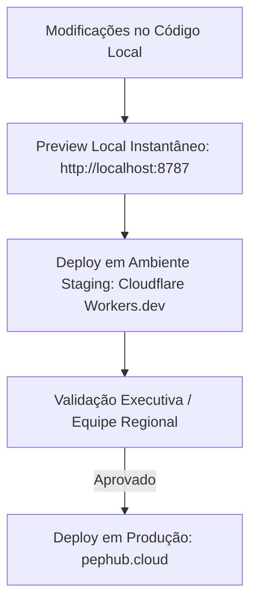

# 📊 Diagnóstico Executivo de Visualização & Insights — PEP HUB

> **Auditoria Completa de Produtos Analíticos da Regional Norte**  
> *Mapeamento minucioso de cada relatório: pontos fortes atuais, oportunidades de melhoria visual (UX/UI) e novos insights preditivos e prescritivos para a tomada de decisão executiva.*

---

## 🧭 Parte 1: Ambiente Secundário de Homologação (Staging & Preview)

Para garantir que você possa **visualizar, interagir e aprovar qualquer mudança antes que ela vá para o site oficial em produção**, foram criadas duas vias seguras de validação:



### 1. Ambiente em Nuvem Secundário (Staging Online)
* **URL Oficial de Staging:** [https://pephub-regional-staging.hurn--afra.workers.dev](https://pephub-regional-staging.hurn--afra.workers.dev)
* **Como subir alterações para o Staging:**
  ```bash
  npx wrangler deploy --env staging
  ```
* **Vantagens:** Ambiente idêntico ao de produção (com o mesmo banco D1 e assets), acessível de qualquer computador ou celular, sem interferir no domínio principal (`pephub.cloud`).

### 2. Preview Local Instantâneo (Hot-Reload)
* **Como iniciar:**
  ```bash
  python scripts/preview.py
  ```
* **O que faz:** Inicia o servidor local na porta `8787` e abre automaticamente seu navegador em `http://localhost:8787`. Qualquer arquivo alterado é refletido imediatamente!

---

## 🔍 Parte 2: Diagnóstico e Insights por Relatório

---

### 1. Painel Churn Banda Larga Total (`/churn-bl-total/`)

#### 📌 Estado Atual
* Monitora 13 praças da Regional Norte (GM e MD) no mês corrente com acompanhamento das 4 tendências semanais (T1 a T4).
* Apresenta matriz de dispersão (Scatter Plot) de Volume vs Taxa, evolução temporal e tabela executiva com cores condicionais.

#### 🎨 Melhorias de Visualização & UX
1. **Cards de KPI com Delta Visual Comparativo:**
   * *Oportunidade:* Hoje os cards exibem o valor absoluto e a taxa de churn em texto.  
   * *Melhoria:* Adicionar uma "pílula de tendência" colorida indicando a variação em relação ao mês anterior (ex: `▲ +0,42 p.p.` em vermelho suave ou `▼ -0,18 p.p.` em verde), permitindo ao diretor bater o olho e saber em 2 segundos se o mês está melhorando ou piorando.
2. **Scatter Plot com Linhas de Média Ponderada Regional:**
   * *Oportunidade:* A matriz de dispersão mostra as cidades espalhadas, mas não traça a linha média da Regional Norte como quadrante.
   * *Melhoria:* Adicionar duas linhas de referência (cruz de quadrantes): a linha vertical da base média e a horizontal da taxa de churn regional. Isso classifica automaticamente as cidades em 4 quadrantes clássicos:
     * *Quadrante Crítico (Alto Volume / Alto Churn):* Exige plano de contenção imediato (ex: Manaus).
     * *Alavanca de Eficiência (Baixo Volume / Alto Churn):* Risco localizado de qualidade técnica.
     * *Porto Seguro (Alto Volume / Baixo Churn):* Benchmark regional de fidelização (ex: Belém).
     * *Operação Estável (Baixo Volume / Baixo Churn).*

#### 💡 Novos Insights Analíticos & Decisórios
* **Índice de Voluntariedade (Ratio Vol/Invol):**
  * Criar um termômetro que mostre a proporção de cancelamentos a pedido do cliente vs corte por inadimplência. Quando a desconexão voluntária sobe, o problema geralmente é **concorrência local agressiva ou insatisfação com velocidade**. Quando a involuntária sobe, o problema é **perfil de crédito de venda ou estresse financeiro regional**.
* **Impacto Financeiro Estimado (Churn MRR Loss):**
  * Multiplicar os cancelamentos pelo ticket médio estimado da banda larga na praça (ex: R$ 99/mês), mostrando a "sangria de receita mensal" evitada ou acumulada no mês.

---

### 2. Painel Churn Banda Larga PME (`/churn-bl-pme/`)

#### 📌 Estado Atual
* Segregação específica do segmento de Pequenas e Médias Empresas (PJ).
* Utiliza a mesma estrutura de dados do Total, porém com dinâmicas de churn corporativo.

#### 🎨 Melhorias de Visualização & UX
1. **Destaque Visual para Contratos de Maior Ticket:**
   * *Oportunidade:* No segmento PME, a perda de um cliente corporativo de 500 Mega ou Link Dedicado com IP Fixo tem peso 5x maior que um plano de entrada.
   * *Melhoria:* Incluir um seletor visual de faixas de velocidade/plano para evidenciar o churn nos planos premium (topo da pirâmide de faturamento).
2. **Sinalizador de Churn em Lote (Encerramento de CNPJs):**
   * *Melhoria:* Adicionar um gráfico de barra empilhada mostrando cancelamentos por agrupamento de motivo (ex: falência/mudança de endereço vs insatisfação).

#### 💡 Novos Insights Analíticos
* **Curva de Risco por Tempo de Casa (Aging PME):**
  * Identificar se as empresas estão cancelando no período de carência (12 meses) com incidência de multa rescisória, ou se o cancelamento ocorre logo após a carência terminar (janela crítica de renovação e fidelização proativa).
* **Alerta de Risco em Cadeia:**
  * Identificação de praças onde a taxa de cancelamento PME está descolada do B2C (se o PME piora antes do residencial, pode ser sinal precoce de crise econômica no polo comercial da cidade).

---

### 3. Painel Executivo FPD — First Payment Default (`/fpd/`)

#### 📌 Estado Atual
* Base com 143.527 domicílios e 100% de contratos mapeados aos nodes (`CD_NODE`).
* Análise de maturação até o marco corporativo de 60 dias (FPD 60) e Onboarding (FPD 30).
* Mapa geoespacial Canvas com laço livre e matriz triangular de safras.

#### 🎨 Melhorias de Visualização & UX
1. **Termômetro de Maturação da Safra Ativa:**
   * *Oportunidade:* A safra mais recente (ex: Maio/2026) ainda está maturando e gera dúvidas sobre quantas faturas já venceram.
   * *Melhoria:* Exibir um indicador de "Idade da Safra" em dias (ex: *Dia 42 de 60 — 70% maturada*), deixando claro aos gestores que os números da safra aberta ainda vão sofrer pequenas variações até o corte final.
2. **Minimapa de "Top 10 Nodes Ofensores" com 1 Clique:**
   * *Oportunidade:* Hoje o usuário usa o laço ou busca na tabela.
   * *Melhoria:* Um botão de atalho visual *"Ver Top 10 Nodes Críticos"* que foca automaticamente a câmera do mapa Canvas diretamente no bairro com maior volume de clientes sem pagamento.

#### 💡 Novos Insights Analíticos
* **Taxa de Cura de Pró-rata (Eficácia da Cobrança Inicial):**
  * Mostrar a porcentagem de clientes que atrasaram a 1ª continha fracionada (1 a 15 dias de pró-rata), mas foram recuperados pela régua de cobrança antes de atingir 60 dias. Se a taxa de cura cair, a régua de SMS/WhatsApp do primeiro vencimento precisa de ajuste urgente.
* **Score de Risco de Fraude / Venda Fantasma (Nunca Pagou nos Primeiros 30 Dias):**
  * Destacar parceiros comerciais onde o percentual de clientes que **nunca pagaram um único real** supera 35%. Isso é o maior alerta operacional de instalação irregular, endereço vago ou documentação frágil.

---

### 4. Painel Churn Safra Consolidado (`/churn/`)

#### 📌 Estado Atual
* Universo de 348.866 instalações ao longo de 13 safras históricas (janelas D30 a D150).
* Avaliação detalhada de responsabilidade do parceiro (D120), mapa de calor por latitude/longitude e ranking comercial hierárquico.

#### 🎨 Melhorias de Visualização & UX
1. **Gráfico de Sobrevivência de Kaplan-Meier (Curva de Sobrevivência):**
   * *Oportunidade:* Hoje as taxas são vistas mês a mês na matriz triangular.
   * *Melhoria:* Um gráfico de linhas em SVG mostrando a "Curva de Sobrevivência da Base": das 1.000 instalações feitas no mês zero, quantas continuam vivas no D30, D60, D90, D120 e D150. Permite comparar visualmente se a safra de 2026 está mais forte que a safra de 2025.
2. **Comparador Lado a Lado de Parceiros:**
   * *Melhoria:* Permitir selecionar 2 parceiros comerciais credenciados para ver suas curvas de perda sobrepostas na mesma tela.

#### 💡 Novos Insights Analíticos
* **Ponto de Inflexão de Retenção (The Retention Cliff):**
  * Calcular estatisticamente o mês em que a probabilidade de cancelamento atinge o pico (normalmente entre D60 e D90) e o momento em que a curva estabiliza. Saber exatamente onde a curva quebra permite concentrar as ligações de CS (Customer Success) exatamente 15 dias antes.
* **Índice de Qualidade do Vendedor (IQV):**
  * Cruzar o volume vendido pelo consultor com o percentual de sobrevivência após o D120, bonificando vendas saudáveis e desincentivando "vendas empurradas".

---

### 5. PeP Tools & Player TV Corporativa (`/pep-tools/divulgacao/` e `/tv`)

#### 📌 Estado Atual
* Módulo para exibição de slides, comunicados e gráficos em telas de TV 16:9 nos refeitórios, salas de operação e escritórios de Manaus e Belém.
* Suporte a streaming de mídia local via Worker e agendamento de campanhas.

#### 🎨 Melhorias de Visualização & UX
1. **Modo Noturno Automático / Alto Contraste:**
   * Garantir visibilidade impecável mesmo em ambientes iluminados ou monitores antigos nas bases operacionais.
2. **Cards Dinâmicos de Conquistas ("Metas Batidas"):**
   * Exibir animações discretas de celebração quando uma cidade atinge a meta de redução de churn na semana (gamificação da operação).

#### 💡 Novos Insights Analíticos
* **Ticker de Notícias Operacionais em Tempo Real:**
  * Uma faixa inferior com destaques automáticos: *"🏆 Belém reduziu a taxa de churn em 0,3% nesta 4ª tendência"*, *"⚡ FPD de Macapá com 92% de adimplência na primeira fatura"*.

---

### 6. Portal Principal Home & Admin (`/` e `/admin/`)

#### 📌 Estado Atual
* Central de acesso protegida por crachá e status do usuário (`pendente`, `aprovado`, `bloqueado`).
* Dashboard de administração com controle de módulos, logs de acesso e estatísticas de uso.

#### 🎨 Melhorias de Visualização & UX
1. **Cards do Portal com Indicadores Rápidos (Quick Summary Badges):**
   * *Oportunidade:* Hoje os cards do portal são estáticos e descrevem o relatório.
   * *Melhoria:* Exibir no próprio card do portal os 2 principais KPIs daquele mês (ex: no card do FPD: `FPD 60: 26,4%` | `Safras: 13`). O gestor já sabe o número antes mesmo de entrar no relatório!
2. **Widget "Últimos Painéis que Você Acessou":**
   * Atalho personalizado no topo para o usuário retornar ao relatório que mais utiliza com 1 clique.

#### 💡 Novos Insights Analíticos
* **Mapa de Calor de Uso dos Painéis (Adoption Analytics):**
  * O administrador consegue ver quais coordenadores estão acessando diariamente os painéis e quais equipes não estão utilizando as ferramentas para tomar decisões.

---

## 📋 Resumo das Próximas Ações Recomendadas

| Prioridade | Relatório / Área | Ação Proposta | Benefício Direto |
|:---:|---|---|---|
| 🥇 **Alta** | **Portal Home (`/`)** | Badges de KPIs resumidos direto nos cards | Gestores veem os indicadores-chave na hora |
| 🥇 **Alta** | **Banda Larga (`/churn-bl-total/`)** | Linhas de quadrante no Scatter Plot e Deltas nos KPIs | Identificação imediata de praças críticas |
| 🥈 **Média** | **FPD (`/fpd/`)** | Indicador de idade da safra ativa e Top 10 Nodes | Fim das dúvidas de maturação e ação rápida em campo |
| 🥈 **Média** | **Churn Safra (`/churn/`)** | Curva de Sobrevivência Kaplan-Meier | Visão cristalina da retenção de clientes ao longo do tempo |
| 🥉 **Geral** | **Staging Workflow** | Uso contínuo do `staging.pephub.cloud` antes do deploy | Zero surpresas em produção |

---
*Documento homologado para orientação do ciclo de evolução de produto PEP HUB.*
