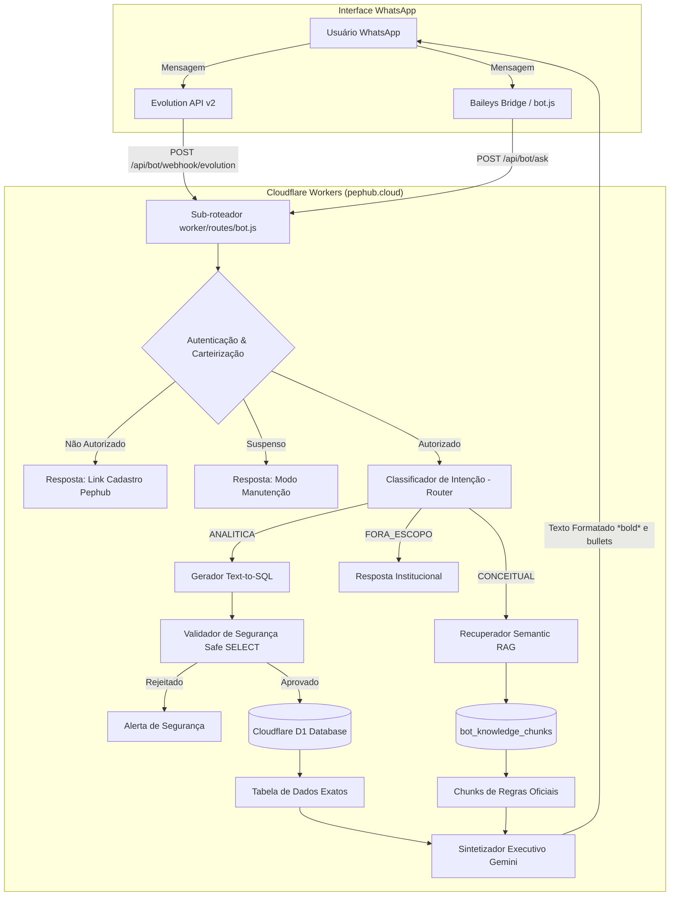

# Manual de Arquitetura — Bot Corporativo de Inteligência de Dados (Agentic RAG & Text-to-SQL)
**Pephub Cloud · Regional Norte (AM, PA, MA, AP, RR)**

---

## 1. Visão Geral e Motivação Arquitetural

O **Pephub Bot** é a interface conversacional da Claro Regional Norte no WhatsApp para fornecer dados operacionais, comerciais e de qualidade para gestores, coordenadores e parceiros autorizados.

### O Desafio da Alucinação Matemática
Sistemas tradicionais de RAG que injetam arquivos CSV/JSON gigantescos no prompt de um LLM sofrem com **alucinações numéricas**, erros de soma/médias e inconsistências de métricas (ex: calcular taxa de churn dividindo pelo número errado ou inventando percentuais).

### A Solução Pephub: Roteamento Semântico Especializado
A nova arquitetura implementa uma divisão estrita de responsabilidade:

1. **Consultas Analíticas (Números, Metas, Volumes, Taxas, Rankings, Safras)**:
   - São encaminhadas para o **Motor Text-to-SQL**.
   - O LLM atua **exclusivamente como compilador de linguagem natural para SQL SQLite (D1)**.
   - Os cálculos matemáticos são executados com **precisão exata e determinística pelo banco de dados relacional Cloudflare D1**.
   - O LLM recebe a tabela de resultados já computada e apenas redige a síntese em tom executivo.
2. **Consultas Conceituais (Fórmulas, Siglas, Definições, Políticas)**:
   - São encaminhadas para o **Motor Semantic RAG**.
   - O sistema recupera chunks de regras oficiais da tabela `bot_knowledge_chunks`.
   - O LLM redige a explicação técnica oficial da Claro (ex: *O que é FPD 60?*, *Como funciona a cura?*, *Qual a regra do D120?*).
3. **Consultas Fora de Escopo**:
   - Recebem resposta imediata e educada delimitando o catálogo operacional disponível.

---

## 2. Diagrama da Arquitetura



---

## 3. Modelagem de Dados no Cloudflare D1

O esquema é definido formalmente em `schema.sql` e garantido em tempo de execução pela função `ensureAppSchema` (`worker/utils/security.js`).

### 3.1. Tabela de Segurança e Carteirização (`dim_carteirizacao`)
Garante o isolamento de escopo por colaborador e número de WhatsApp:

| Coluna | Tipo | Descrição |
|---|---|---|
| `id` | TEXT PRIMARY KEY | Identificador único do registro |
| `telefone` | TEXT UNIQUE | Telefone normalizado com DDI+DDD (ex: `5591999999999`) |
| `user_id` | TEXT | Chave estrangeira para a tabela `users` |
| `nome` | TEXT | Nome do colaborador ou entidade |
| `regional` | TEXT | Escopo regional (`REGIONAL NORTE`) |
| `canal` | TEXT | Escopo de canal (`TODOS`, `PAP`, `Lojas`, `Agentes`) |
| `cidade` | TEXT | Escopo municipal (`TODAS`, `Belém`, `Manaus`, etc.) |
| `permissao_total` | INTEGER | `1` = Acesso a toda a regional; `0` = Restrito ao escopo municipal |

### 3.2. Fato Indicadores Mensais (`fato_indicadores_mensais`)
Consolida métricas de **Banda Larga Total** e **Banda Larga PME**:

- `segmento`: `'Banda Larga Total'` ou `'Banda Larga PME'`
- `mes_referencia`: Ex: `'Setembro / 2026'`
- `tipo_visao`: `'TOTAL'`, `'VOLUNTARIO'`, `'INVOLUNTARIO'`
- `cidade`: Ex: `'Regional Norte'`, `'Belém'`, `'Manaus'`, `'São Luís'`, etc.
- `vol_real`, `vol_orc`, `rxo_delta`, `rxo_pct`: Volumes realizados vs meta orçada
- `taxa_real`, `taxa_orc`, `taxa_delta_pp`: Taxas percentuais de churn
- `tendencia_t1` a `tendencia_t4`: Tendências projetadas do mês
- `ytd_real`, `ytd_orc`: Acumulado do ano (Year-To-Date)

### 3.3. Fato Churn Safra D120 (`fato_churn_safra`)
Consolida a sobrevivência histórica e apuração de clawback:

- `safra`: Ex: `'set/25'`, `'out/25'`, ..., `'mai/26'`, `'ago/26'`
- `visao`: `'REGIONAL'`, `'CIDADE'`, `'PARCEIRO'`, `'OPERACAO'`
- `entidade_nome`: Nome da praça, operação ou parceiro credenciado
- `instalacoes`: Contratos instalados no mês da safra
- `churn_d30`, `churn_d60`, `churn_d90`, `churn_d120`: Cancelamentos por marco temporal
- `np120`: Contratos cancelados/cortados por inadimplência em D120
- `taxa_d120`, `taxa_np120`: Percentuais oficiais calculados
- `status_safra`: `'MADURA'` (>= 120 dias) ou `'EM_ABERTO'`

### 3.4. Fato First Payment Default (`fato_fpd`)
Mede a inadimplência nos primeiros 60 dias:

- `safra`: Ex: `'mai/26'`
- `cidade`, `uf`, `canal`, `familia_produto`
- `instalacoes`: Volume de domicílios instalados
- `fpd30`, `taxa_fpd30`: Inadimplência pró-rata inicial
- `fpd60`, `taxa_fpd60`: Inadimplência de ciclo cheio acumulada
- `cura`, `taxa_cura`: Contratos regularizados entre 30 e 60 dias
- `faixa_risco`: `'BAIXO'`, `'MEDIO'`, `'ALTO'`, `'CRITICO'`

### 3.5. Fato Aprovação de Crédito PF (`fato_aprovacao_credito`)
Métricas de aprovação e recusas da financeira:

- `mes_referencia`: Ex: `'2026-09'`
- `cidade`, `canal`, `pdv_ou_parceiro`
- `consultas`: Total de propostas submetidas
- `aprovados`, `taxa_aprovacao`: Propostas aprovadas
- `recusas_politica`, `recusas_antifraude`, `risco_alto`: Segmentação de recusas

### 3.6. Fato Market Share Anatel (`fato_market_share`)
Posicionamento competitivo Claro vs concorrência:

- `mes_referencia`: Ex: `'2026-09'`
- `cidade`, `uf`
- `operadora`: `'Claro'`, `'Vivo'`, `'Oi'`, `'Competitivas/ISPs'`
- `acessos`, `market_share_pct`, `net_adds`, `posicao_ranking`

### 3.7. Base Semântica RAG (`bot_knowledge_chunks`)
Conhecimento estruturado de regras, siglas e fórmulas:

- `modulo`: Módulo de negócio (`churn-safra`, `fpd`, `churn-bl-total`, etc.)
- `topico`: Título do conceito ou regra
- `conteudo`: Explicação oficial validada pela diretoria
- `palavras_chave`: Termos para busca e recuperação semântica
- `regras_calculo`: Fórmula matemática exata

---

## 4. Segurança e Prevenção de Injeção SQL

A execução de Text-to-SQL em ambientes corporativos exige barreiras ativas contra vazamento e manipulação de dados:

1. **Validação de Sintaxe Segura (`validateSafeSQL`)**:
   - Apenas comandos iniciados por `SELECT` ou `WITH` são autorizados.
   - Qualquer comando de mutação (`INSERT`, `UPDATE`, `DELETE`, `DROP`, `ALTER`, `CREATE`, `REPLACE`, `EXEC`, `PRAGMA`) é **imediatamente interceptado e rejeitado** antes de atingir o banco.
   - Comentários de bypass (`--`, `/*`) e múltiplos comandos separados por `;` são bloqueados.
2. **Isolamento de Escopo por Carteirização**:
   - Quando o colaborador não possui `permissao_total = 1`, o roteador injeta restrições obrigatórias na cláusula `WHERE` vinculadas à sua cidade ou canal autorizado.
3. **Telemetria de Auditoria**:
   - Tentativas com sintaxe maliciosa são registradas no console e trilha de auditoria corporativa.

---

## 5. Como Adicionar Novos Relatórios e Indicadores

O sistema foi arquitetado de forma modular para que novas ferramentas e relatórios sejam incorporados em 4 passos simples:

### Passo 1: Criar a Tabela no D1
Edite `schema.sql` e adicione a tabela de fato com colunas indexadas:
```sql
CREATE TABLE IF NOT EXISTS fato_novo_indicador (
    id TEXT PRIMARY KEY,
    mes_referencia TEXT NOT NULL,
    cidade TEXT NOT NULL,
    indicador_nome TEXT NOT NULL,
    valor REAL DEFAULT 0,
    created_at DATETIME DEFAULT CURRENT_TIMESTAMP
);
CREATE INDEX IF NOT EXISTS idx_novo_ind ON fato_novo_indicador(mes_referencia, cidade);
```
*(Adicione também no método `ensureAppSchema` em `worker/utils/security.js`)*.

### Passo 2: Informar o Esquema no Prompt do Gerador SQL
Em `worker/routes/bot.js`, adicione a nova tabela dentro da constante `schemaContext`:
```javascript
7. fato_novo_indicador:
   - mes_referencia TEXT ('2026-09')
   - cidade TEXT ('Belém', 'Manaus')
   - indicador_nome TEXT ('Taxa de Reparo', 'SLA')
   - valor REAL
```

### Passo 3: Adicionar a Rotina no Seed (`scripts/seed_d1_bot_data.py`)
No script de carga, leia os dados do arquivo gerado pelo ETL (JSON ou CSV) e gere os comandos `INSERT OR REPLACE INTO fato_novo_indicador (...)`.

### Passo 4: Cadastrar Regras e Fórmulas em `bot_knowledge_chunks`
Adicione na lista de chunks do `scripts/seed_d1_bot_data.py`:
```python
{
    "modulo": "novo-modulo",
    "topico": "Como calcular o SLA de Reparo",
    "pergunta_exemplo": "Como é calculado o SLA de Reparo?",
    "conteudo": "O SLA de Reparo mede o percentual de ordens de serviço resolvidas em até 24 horas...",
    "palavras_chave": "sla, reparo, prazo, atendimento tecnico",
    "regras_calculo": "OS resolvidas <= 24h / Total de OS * 100"
}
```

Execute o reprocessamento:
```bash
python scripts/seed_d1_bot_data.py
npx wrangler d1 execute pephub-db --file=./seed_bot_data.sql
```
**Pronto! O bot passará a responder instantaneamente sobre o novo relatório sem necessidade de reescrever lógica no código.**

---

## 6. Endpoints da API

### `POST /api/bot/ask`
Utilizado pelo Baileys bot, CLI, aplicações externas ou ferramentas de teste interno.

**Headers:**
```http
Content-Type: application/json
```

**Payload:**
```json
{
  "phone": "5591999999999",
  "query": "Qual foi a taxa de churn de Belém em setembro?"
}
```

**Exemplo de Resposta (Analítica):**
```json
{
  "success": true,
  "intent": "ANALITICA",
  "phone": "5591999999999",
  "sql": "SELECT cidade, vol_real, taxa_real FROM fato_indicadores_mensais WHERE segmento = 'Banda Larga Total' AND cidade LIKE '%Belém%' AND tipo_visao = 'TOTAL' AND mes_referencia LIKE '%Setembro%'",
  "rowsCount": 1,
  "answer": "📊 *Regional Norte · Claro*\n\nEm *Setembro / 2026*, a operação de *Belém* (Banda Larga Total) registrou:\n• Volume Realizado: *2.014,9* desconexões\n• Taxa de Churn: *1,88%*\n\nO resultado ficou abaixo da meta orçada de 1,99%, representando uma performance favorável de -0,11 p.p."
}
```

### `POST /api/bot/webhook/evolution`
Webhook oficial cadastrado na **Evolution API v2**. Recebe eventos do tipo `messages.upsert`, processa o remitente, valida carteirização, executa o RAG e despacha a mensagem formatada para a Evolution API.

### `GET /api/bot/status`
Healthcheck e diagnóstico de suspensão administrativa do bot.

---

## 7. Procedimentos de Teste e Validação

Para verificar a integridade da suíte de RAG e Text-to-SQL:

```bash
# 1. Executa a suíte de testes unitários e de integração
python scripts/test_bot_rag.py

# 2. Executa a auditoria de Release Gate corporativo
python scripts/release_gate.py
```

Ambos devem reportar **APROVADO** com nota máxima antes de qualquer deploy em produção.
