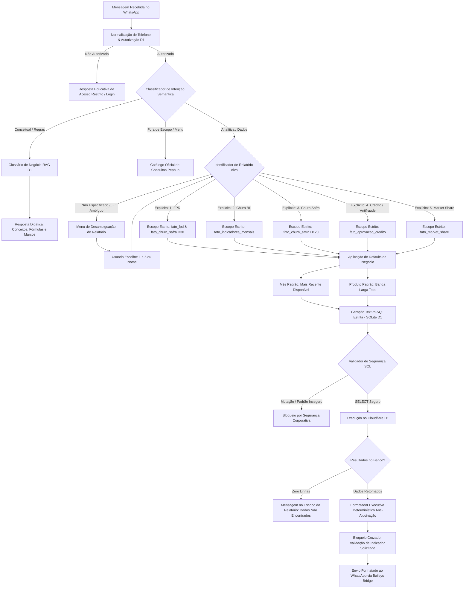

# Arquitetura & Fluxograma da Construção da Resposta
**Pephub Data Bot · WhatsApp RAG Corporativo (Regional Norte)**

Este documento descreve detalhadamente o pipeline de tomada de decisão, roteamento semântico, desambiguação de relatórios, bloqueio contra cruzamento indevido de indicadores e formatação anti-alucinação executado em cada mensagem recebida pelo WhatsApp.

---

## 1. Visão Geral do Pipeline de Construção da Resposta



---

## 2. As 4 Regras de Ouro do Pipeline

### Regra 1: Desambiguação Inicial de Relatório (Anti-Cruzamento)
Quando um usuário faz uma pergunta ampla que não explicita qual indicador deseja consultar (ex.: *"Como está a CCH Mendes?"* ou *"Qual o resultado de Belém?"*), o bot **não adivinha** e **não despeja um relatório aleatório**. Ele pausa a execução e apresenta o menu estruturado:
```
🤔 Pephub Bot · Selecione o Relatório Desejado
Para consultar com precisão e evitar cruzar dados diferentes sobre *Manaus*, selecione o relatório:
1️⃣ FPD (Inadimplência de 1º Pagamento, FPD 30/60 e Cura)
2️⃣ Churn Banda Larga (Desconexão Total, Voluntária e Involuntária)
3️⃣ Churn Safra D120 (Sobrevivência de Venda e Estorno)
4️⃣ Aprovação de Crédito (Fraudes, Reprovações e Mix de Risco)
5️⃣ Market Share (Participação de Mercado e Net Adds)
```
Se a pergunta já for explícita (ex.: *"Qual o FPD da CCH Mendes em Junho/26?"*), o bot detecta o relatório **FPD** automaticamente e prossegue sem intermediários.

### Regra 2: Bloqueio Estrito de Cruzamento de Indicadores
* Se a consulta é sobre **FPD**, o bot é terminantemente proibido de exibir tabelas de Churn Safra D120 ou Speech Analytics.
* Se a base oficial de FPD detalhada por faixas de risco não contemplar uma entidade específica (como um parceiro comercial individual), o bot informa a métrica oficial de primeiro pagamento correspondente (*FPD 30 / Taxa D30*) e explica com transparência a granularidade da base corporativa.
* Caso a consulta não encontre dados no relatório solicitado, o bot responde:
  `⚠️ Não foram encontrados registros no relatório de ${NOME_RELATORIO} para os filtros informados.`
  Jamais troca para outro relatório sem autorização expressa do usuário.

### Regra 3: Regras de Negócio Padrão (Defaults)
* **Mês Padrão:** Sempre que o usuário não especificar mês ou safra, o bot seleciona automaticamente o **mês mais recente com dados disponíveis** (ex.: `Setembro / 2026` para Churn BL, `2026-09` para Crédito/MKT, ou a safra mais recente).
* **Produto Padrão:** Sempre que não for especificado produto, o bot adota **Banda Larga** (`segmento = 'Banda Larga Total'`, `familia_produto = 'Dados'`).

### Regra 4: Anti-Alucinação Absoluta (Zero Hallucination)
* Os números exibidos nas mensagens são extraídos **diretamente das linhas retornadas pelo Cloudflare D1**, sem arredondamentos arbitrários, sem estimativas e sem suposições da LLM.
* O template executivo formatador garante que cada indicador possua sua sigla, sua safra/mês de apuração e seu contexto corporativo fiel.

---

## 3. Matriz dos 5 Relatórios Oficiais & Mapeamento de Tabelas

| # | Relatório Oficial | Indicadores Chave | Tabela D1 Principal | Tabela Secundária / Exceção |
| :-: | :--- | :--- | :--- | :--- |
| **1** | **FPD (First Payment Default)** | FPD 30, FPD 60 Efetivo, Taxa de Cura, Faixas de Risco (Baixo a Crítico), Score 0/1 | `fato_fpd` (Cidade, Canal, Risco) | `fato_churn_safra` (`churn_d30` e `taxa_d30` quando for Parceiro Comercial) |
| **2** | **Churn Banda Larga** | Taxa Churn Real vs Orçado, Volume Desconexão, Voluntário (Opção), Involuntário, Speech Analytics | `fato_indicadores_mensais` | — |
| **3** | **Churn Safra D120** | Instalações, Cancelamentos D120, Taxa D120, NP120, Perdas Inadimplência/Fraude, Safra Madura | `fato_churn_safra` | — |
| **4** | **Aprovação de Crédito & Antifraude** | Consultas, Aprovados, Taxa de Aprovação %, Recusas por Política, Recusas Antifraude, Mix de Alto Risco | `fato_aprovacao_credito` | — |
| **5** | **Market Share (Anatel)** | Acessos, Participação de Mercado Claro vs Concorrência (Vivo, Oi, ISPs), Net Adds, Ranking | `fato_market_share` | — |

---

## 4. Exemplos de Execução do Pipeline

### Exemplo 1: Pergunta Explícita sobre Parceiro em Safra Fechada
* **Pergunta:** *"Qual o FPD da CCH Mendes em Junho/26?"*
* **Detecção:** Relatório = `FPD` (Explícito). Entidade = `CCH Mendes`. Safra = `jun/26`.
* **Execução SQL:**
  ```sql
  SELECT safra, entidade_nome, instalacoes, churn_d30, taxa_d30, np120, taxa_np120, status_safra 
  FROM fato_churn_safra 
  WHERE visao = 'PARCEIRO' AND entidade_nome LIKE '%CCH Mendes%' AND safra = 'jun/26' LIMIT 1;
  ```
* **Resposta Gerada:**
  ```
  💳 Relatório Oficial de FPD (First Payment Default) · Regional Norte

  • Parceiro: CCH MENDES SERVICOS EIRELI EPP
  • Safra Consultada: jun/26 (Em Acompanhamento)
  • Instalações da Safra: 65 contratos

  📊 Indicadores de Primeiro Pagamento:
  • FPD 30 (Taxa D30): 0,00% (0 cancelamentos nos primeiros 30 dias)
  • Não Pagos D120 (NP120): 6,15% (4 contratos sem pagamento)
  • Inadimplência Inicial: 2 contratos

  ℹ️ Nota de Conformidade: O relatório analítico de FPD detalhado por faixas de risco e cura de 60 dias é consolidado por Cidade e Canal. Para parceiros de venda comerciais, o acompanhamento de 1º pagamento é realizado através do FPD 30 (D30).
  ```

### Exemplo 2: Pergunta sobre Market Share e Net Adds
* **Pergunta:** *"Qual o Market Share da Claro e a média de Net Adds dos últimos meses em Belém?"*
* **Detecção:** Relatório = `MARKET_SHARE` (Explícito). Cidade = `Belém`.
* **Execução SQL:**
  ```sql
  SELECT operadora, market_share_pct, acessos, net_adds, posicao_ranking 
  FROM fato_market_share 
  WHERE cidade = 'Belém' AND mes_referencia = (SELECT MAX(mes_referencia) FROM fato_market_share WHERE cidade = 'Belém')
  ORDER BY market_share_pct DESC;
  ```

### Exemplo 3: Pergunta Ambígua (Ativação da Regra 1)
* **Pergunta:** *"Como está o resultado de Manaus?"*
* **Detecção:** Relatório = `AMBÍGUO`. Entidade = `Manaus`.
* **Ação:** Interrompe a execução, envia o menu de 5 opções interativas e aguarda a definição do relatório antes de consultar o banco.
